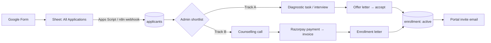
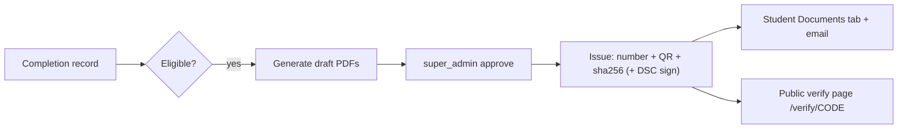

# 04 – User Flows

## F1. Applicant → enrolled

1. Every new form response already gets a Candidate ID in the Sheet. The script also POSTs it to `/api/applicants/import` (signed secret) → upsert by `candidate_code`.
2. Admin filters (role, year, availability, CV present), changes status: `shortlisted / on_hold / not_now`.
3. Track A: mentor runs Day 1–2 diagnostic (scores recorded) → interview note → admin creates enrolment (duration, mentor, dates, engagement type free/paid/stipend + amount) → offer letter generated → candidate accepts in portal (click + timestamp).
4. Track B: counselling call logged → payment link → on `payment.captured` webhook: invoice + enrollment letter + enrolment active.
5. Invite email with Google sign-in link; first login links `auth.users` ↔ `profiles` ↔ `applicants`.

## F2. Track A intern – daily loop
Login → Today screen: current milestone, tasks due, "Post daily update" button → update form (playbook template) → tasks board (To do → In progress → In review) → mentor reviews (Accepted / Revision) → Friday demo → weekly report auto-prefilled from daily updates.

## F3. Mentor loop
Dashboard: my interns (route, current milestone, last update, blockers, items in review) → review task / write mentor review (decision accepted/revise/rescope) → schedule live session → midpoint/final rescore → final demo checklist → mark completion record.

## F4. Track B trainee
Course home → week unlocked → watch lesson (video) → quiz → assignment submit → weekly live (join link, attendance) → capstone tasks (same task board as Track A) → final demo → grade computed → certificate.

## F5. Live session
Mentor/admin: "Schedule" (batch, time, agenda) → Google Calendar event with Meet link → invite to batch emails → reminder (n8n: WhatsApp/email 1h before) → attendance (auto from join click + mentor confirm) → recording link added.

## F6. Completion → documents

## F7. Verification (public)
Scan QR → `/verify/QF-C-2627-AA-0001` → shows name, document type, programme, role, dates, grade, issue date, status (VALID / REVOKED) + optional "Upload PDF to check" (sha256 compare) → never shows contact details.

## F8. Revocation
super_admin opens document → Revoke (reason) → status REVOKED, verify page updates instantly, audit log entry, student notified.
