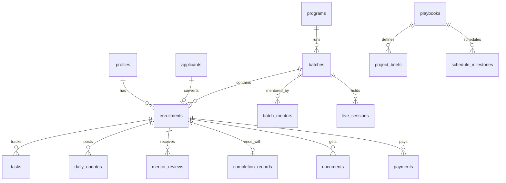

# 06 – Data Model (Postgres / Supabase)

Conventions: `id uuid pk default gen_random_uuid()`, `created_at/updated_at timestamptz`, soft delete only where stated. All tables in `public` with RLS ON.

## Enums
```sql
user_role         : super_admin | admin | mentor | student
program_track     : merit | paid | self_paced                -- A / B / C (how the programme runs)
engagement_type   : free | paid | stipend                    -- money terms, set per enrolment by admin (D-04)
duration_plan     : d45 | d90 | m6
applicant_status  : new | shortlisted | on_hold | not_now | converted
enrollment_status : invited | offer_sent | accepted | payment_pending | active | paused | completed | withdrawn | terminated
training_route    : foundations | guided | accelerated
task_status       : todo | in_progress | in_review | revision | accepted
review_decision   : accepted | revise | rescope
document_type     : offer_letter | enrollment_letter | agreement | certificate_completion | certificate_excellence
                  | certificate_project | experience_letter | relieving_letter | lor | invoice | grade_report
document_status   : draft | pending_approval | issued | revoked
payment_status    : created | paid | failed | refunded
```

## Identity
| Table | Key columns |
|---|---|
| `profiles` | id (= auth.users.id), role, full_name, display_name_on_docs, email, phone_e164, college, course, year_of_study, photo_path, linkedin, github, is_active |
| `roles_catalog` | code (`AA`, `GA`, `FS`, `BE`, `DO`, `ML`, `BD`, `SE`, `QA`, `FE`, `MA`, `UX`, `GD`, `3D`, `DA`, `RD`), name, track_group (AI & Automation / Software / Design / Data / QA / Business / R&D), is_launch_track (AA, GA, FS, SE, QA, DO, ML = true), form_label (exact text used in the Google Form) |

## Admin settings (everything configurable – D-05)
| Table | Key columns |
|---|---|
| `org_settings` | singleton row: org_name ("Quellflow Technologies LLP"), brand_name ("Quellflow"), address, llpin, website, contact_email, sender_name, sender_email, verify_base_url, logo_path, timezone ('Asia/Kolkata'), academic_year_start_month (default 6 = June), current_academic_year_label (computed or override, e.g. '2627') |
| `numbering_schemes` | doc_type, pattern (e.g. `QF/OFR/{AY}/{SEQ:4}`, `QF-C-{AY}-{ROLE}-{SEQ:4}`), reset_per_academic_year bool, is_active, updated_by |
| `signatories` | name, title, signature_path (private storage), stamp_path, is_active, sort |
| `doc_template_signatories` | template_id, signatory_id, position (left/center/right) |

Tokens available in patterns: `{AY}` academic year label · `{YYYY}` · `{ROLE}` role code · `{TRACK}` A/B · `{SEQ:n}` zero-padded sequence. Changing a pattern affects only documents issued afterwards.

## Intake
| `applicants` | candidate_code (QF-2627-0001, unique), form_response_id (unique), email, full_name, phone_e164, city, college, degree, year, role_code, role_other, skills, portfolio_url, prev_internship, cv_url, can_start, hours_per_week, work_mode, extra, submitted_at, status, notes, profile_id (after conversion) |
| `applicant_status_history` | applicant_id, from_status, to_status, by, at, note |

## Programme content
| `playbooks` | role_code, version, title, tagline, calendar_rules, mentor_prep, working_boundaries, published, created_by |
| `playbook_modules` | playbook_id, sort, title, mentor_teaches, intern_practises, ready_when |
| `diagnostic_templates` | playbook_id, day (1/2), agenda, task_brief (student), mentor_notes (cues), sample_cases jsonb |
| `rubric_dimensions` | code (fundamentals, execution, problem_solving, communication, verification), title, description |
| `project_briefs` | playbook_id, duration, problem, title, required_scope, outside_scope, handover_package |
| `acceptance_checks` | project_brief_id, sort, text |
| `schedule_milestones` | playbook_id, duration, sort, label ("Days 8 to 14" / "Week 5"), start_day, end_day, mentor_actions, intern_tasks, deliverable, review_criteria |
| `quality_checks` | playbook_id, title, description |
| `playbook_resources` | playbook_id, title, url, exercise |
| `courses` (Track B) | role_code, title, slug, description, duration, published, version |
| `course_modules` | course_id, week_no, title, unlock_offset_days |
| `lessons` | module_id, sort, title, kind (video/text/link/file), video_url, body_md, resources jsonb, est_minutes |
| `quizzes` / `quiz_questions` | lesson_id or module_id, question, options jsonb, correct jsonb, points |
| `assignments` | module_id, title, brief_md, rubric jsonb, max_points, due_offset_days |

## Delivery
| `programs` | name, track, role_code, duration, playbook_id (A) / course_id (B), active – unique(track, role_code, duration) |
| `program_pricing` | program_id (pk), default_fee_inr, gst_rate – **admin-only table** (RLS) so fees never leak to mentors/students |
| `invitations` | email, role, applicant_id, invited_by, profile_id, accepted_at, revoked_at – one pending invite per email; consumed by `handle_new_user()` on first sign-in |
| `batches` | program_id, code (e.g. AA-2701), name, start_date, end_date, capacity, live_slot (text), status |
| `batch_mentors` | batch_id, mentor_id, is_backup |
| `enrollment_terms` | enrollment_id (pk), **engagement_type** (free/paid/stipend), stipend_amount_inr, stipend_frequency (monthly/one_time), fee_amount_inr – **separate admin-only table** (RLS: admin + that candidate only; mentors excluded) (D-04) |
| `enrollments` | profile_id (null until invite accepted), applicant_id, batch_id, program_id, status, start_date, end_date, weekly_hours, working_days, mentor_id, backup_mentor_id, project_brief_id, reduced_scope_note, review_slots, approved_tools, budget_limit_inr, handover_owner, route, offer_accepted_at, playbook_version |
| `diagnostic_scores` | enrollment_id, stage (day1/day2/day7/midpoint/final), dimension_code, score 0–4, evidence_url, observation, scored_by |
| `scope_changes` | enrollment_id, removed, reason, new_checks, decided_by, at |
| `tasks` | enrollment_id, milestone_id null, title, description, owner_id, due_date, acceptance_check, status, evidence_url, mentor_decision, next_action |
| `task_events` | task_id, from_status, to_status, by, at, comment |
| `daily_updates` | enrollment_id, work_date, planned, completed, completed_link, checked_by, learned, blocker, next_day — unique(enrollment_id, work_date) |
| `weekly_reports` | enrollment_id, week_start, agreed_goal, demo_link, checks_passed, checks_failing, feedback_changes, hours_learning, hours_delivery, assistance_used, risks, next_goal, help_needed |
| `blockers` | enrollment_id, expected, actual, repro_steps, attempts, example_link, decision_needed, parallel_task, resolved_at |
| `mentor_reviews` | enrollment_id, milestone_label, demonstration, evidence, explained_well, gap, decision, next_assignment, support, next_review_date, published |
| `live_sessions` | batch_id, title, agenda, starts_at, ends_at, meet_url, calendar_event_id, recording_url, host_id |
| `attendance` | live_session_id, profile_id, status (present/absent/excused), joined_at, marked_by |
| `lesson_progress` | enrollment_id, lesson_id, completed_at |
| `quiz_attempts` | enrollment_id, quiz_id, answers jsonb, score, attempted_at |
| `submissions` | enrollment_id, assignment_id, file_path / url, submitted_at, score, feedback, graded_by, graded_at |
| `final_reviews` | enrollment_id, demo_at, checklist jsonb (35-min agenda items), outcome |
| `final_reports` | enrollment_id, sections jsonb (9 sections), submitted_at |
| `completion_records` | enrollment_id, actual_start, actual_end, approved_leave_days, scope_changes_summary, project_link, acceptance_decision, final_score_pct, grade (distinction/merit/completion/none), attendance_pct, mentor_feedback, receiving_owner, approved_by, approved_at |

## Documents & money
| `doc_templates` | type, track, version, name, pdfme_schema jsonb, base_pdf_path, active, created_by |
| `document_sequences` | scheme_id, academic_year_label, role_code null, last_no – unique(scheme_id, academic_year_label, role_code) |
| `documents` | type, number (QF/OFR/2627/0001) / code (QF-C-2627-AA-0001) unique, enrollment_id, profile_id, template_id, data jsonb (snapshot of all fields), pdf_path, sha256, dsc_signed bool, status, version, supersedes_id, issued_by, issued_at, approved_by, revoked_by, revoked_at, revoke_reason |
| `payments` | enrollment_id, razorpay_order_id, razorpay_payment_id, amount_inr, gst_inr, status, invoice_document_id, paid_at, refund_amount, refund_note |
| `announcements` | scope (all/batch), batch_id, title, body_md, created_by, published_at |
| `notifications` | profile_id, kind, payload jsonb, read_at |
| `audit_log` | actor_id, action, entity, entity_id, before jsonb, after jsonb, at, ip |

## Key relations


## Database functions
- `next_document_number(doc_type, role_code)` – reads active `numbering_schemes` pattern + academic year from `org_settings`, locks the `document_sequences` row, returns the formatted number/code.
- `academic_year_label(ts)` – e.g. 15-Jan-2027 with start month 6 → `'2627'`.
- `verify_document(code text)` – `security definer`, returns public fields only.
- `is_admin()`, `is_super_admin()`, `is_batch_mentor(batch uuid)`, `my_enrollment_ids()` – used in RLS.
- Trigger: `audit_log` on documents, enrollments, completion_records, payments, profiles.role.
