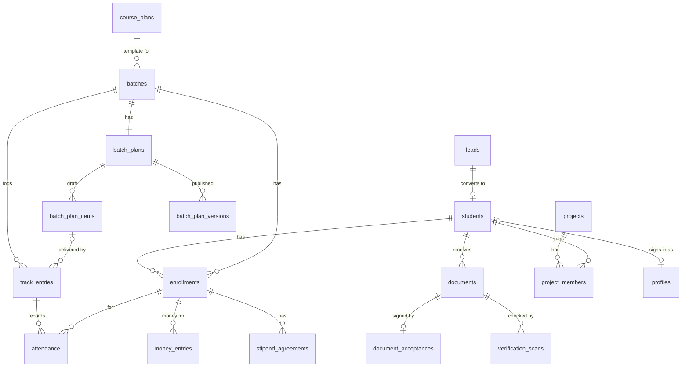

# 19 – Database, flows and pipelines (build spec for plan v2.4)

**Status:** v1.0 for review (27-Nov-2026). Written against the final screens in the UI preview (https://claude.ai/artifact/7XZ36hmJZDDeV6tSZhbZ7Q).
Where this document conflicts with `18_PLAN_V2.md` §5, §7, §8, §10 or §12, **this document wins**. Nothing here is built yet; Step A implements §2–§5.

Contents: 1 Decisions added · 2 Database · 3 Derived values (views) · 4 Security (RLS) · 5 Integrity rules · 6 State machines · 7 Action map (every button) · 8 Pipelines · 9 Daily jobs · 10 Screen → data map · 11 Phase 1 → v2 migration · 12 Build steps · 13 Open points

---

## 1. Decisions added in this spec

| # | Decision | Why |
|---|---|---|
| DB-1 | **`students` is its own table**, separate from `profiles`. `profiles` = signed-in accounts (admin or student). A student record exists before the person ever signs in; `students.user_id` is filled on their first sign-in (matched by email). | Admin creates a student first; the login comes later. Phase 1 tied every profile to an auth user, which cannot hold a not-yet-signed-in student. |
| DB-2 | **The portal issues all codes.** Lead code = student code = `QF-<AY>-<SEQ4>` (e.g. QF-2627-0012) from one sequence. The Google Form's Apps Script stops generating IDs: on submit it calls the portal import API, gets the code back, then sends the acknowledgement email. | One issuer, no collisions between form leads and walk-in leads. The code follows the person from lead to student to documents. |
| DB-3 | **Lead stages = the screens:** New → Contacted → Interested → Counselling → Converted, or Lost (with a reason). | Matches the board and filters. |
| DB-4 | **Assignment happens only in Student 360 → Enrolment.** The batch Students tab links to the Students list filtered to "Not assigned". | Single owner for enrolments, as the screens show. |
| DB-5 | **Fee = an agreed amount on the enrolment**, payments are ledger entries against it. Pending fee = agreed − paid + refunded. Part payments are just more entries. | Matches "Fees pending ₹6,000" and "part 1 of 2". No fake "expected" rows for fees. |
| DB-6 | **Stipend = monthly "expected" rows** created on the 1st for every active stipend enrolment (amount from the agreement, editable). Paying = recording the transfer on that row. The "Stipend run" tab is just the rows of one month. | Matches the run screen, keeps one ledger. |
| DB-7 | **Nothing with history is hard-deleted.** "Delete" in the UI means *void* (money), *archive* (student, project), *lost* (lead), *withdrawn/dropped* (enrolment), *revoked* (document), or a soft delete (`deleted_at`) for plan items and session records. Only draft plan items are really deleted. | Audit trail, and it makes Undo possible. |
| DB-8 | **Undo = a reverse action**, offered for 5 seconds. The server action returns the row id; Undo calls the matching restore action (un-void, un-archive, restore). Everything is in `audit_log`. | Simple, and the database is always truthful. |
| DB-9 | **Batch plan has a draft and a published copy.** Edits change `batch_plan_items` (draft). Publish writes a frozen JSON snapshot into `batch_plan_versions`. The share link always shows the latest published snapshot. | Students never see half-finished edits. |
| DB-10 | **Live-track entries carry attendance and results.** One session record = one `track_entries` row + `attendance` rows + optional `work_results` rows. | Matches the Log session form. |
| DB-11 | **Students do not see money.** No money table is readable by students (the student Payments screen was removed). | Owner request; stipend amounts stay private. |
| DB-12 | **Public pages never read tables.** The shared plan and the verify page call two security-definer functions that return only safe fields and log the visit. | Anon role has no table access at all. |
| DB-13 | **Lists are paged on the server, 10 rows per page.** Filters, tab and page live in the URL query (`?tab=ledger&month=2026-12&page=2`) so links and the Back button work. Mobile uses the same API with "View more" (next page appended). | Fast on the free tier, shareable links. |

---

## 2. Database

Conventions: every table has `id uuid pk default gen_random_uuid()`, `created_at timestamptz default now()`, `updated_at` (trigger), `created_by uuid → profiles`. Money is **whole rupees** (`int`, > 0). Dates the user picks are `date`; events are `timestamptz` (stored UTC, shown IST). Text codes are `unique`. `*` = not null.

### 2.1 Enums
```
user_role          admin | student
lead_stage         new | contacted | interested | counselling | converted | lost
lead_source        form | whatsapp | referral | walk_in | other
lost_reason        not_interested | no_response | not_eligible | joined_elsewhere | duplicate | spam
activity_kind      call | whatsapp | email | meeting | note | system
student_type       paid | free | stipend
student_state      active | alumni | archived
batch_status       planned | running | completed | cancelled
enrollment_status  assigned | active | completed | not_completed | withdrawn | dropped | transferred
plan_kind          session | task | test | milestone | buffer
attendance_mark    present | absent | leave
work_mark          done | late | missing | excused
money_category     fee | refund | stipend | bonus | other_in | other_out
money_status       expected | done | void
pay_mode           upi | imps | neft | bank_transfer | cash | other
doc_type           offer | tnc | consent | joining | certificate | experience | lor | project_certificate
doc_status         draft | issued | accepted | revoked | superseded
project_kind       client | college | internal
project_status     planned | active | on_hold | completed | cancelled
report_status      not_started | draft | reviewed | submitted | approved
scan_result        valid | revoked | superseded | not_found
```

### 2.2 Accounts and settings
| Table | Columns | Notes |
|---|---|---|
| **profiles** | `id` (= auth.users.id) · `role*` · `is_owner*` · `full_name*` · `email*` (lower-case, unique) · `phone` · `is_active*` · `last_seen_at` | Signed-in people only. Kept from Phase 1, mentor roles removed. |
| **invitations** | `email*` · `role*` · `student_id` · `invited_by` · `expires_at` · `accepted_at` | Kept. A student invite is created with the student. |
| **org_settings** (1 row) | legal name, website, support email/WhatsApp · `verify_base_url*` · `local_files_root*` · `file_patterns` (jsonb) · `min_attendance_pct*` (75) · `min_task_pct*` (70) · `working_days` (jsonb, Mon–Fri default) · `holidays` (jsonb list of dates) · `stipend_pay_by_day*` (5) · `academic_year_start_month*` (6) | Edited only in Settings. |
| **numbering_schemes** | `kind*` (lead, batch, document:<type>, project:<kind>) · `pattern*` · `padding*` | Kept from Phase 1, new kinds added. |
| **number_sequences** | `kind*` · `scope*` (e.g. `2627` or `2627-AA`) · `last_value*` | Renamed from `document_sequences`; used for every code. Row-locked `next_number()` function. |
| **signatories** | `name*` · `title*` · `signature_image` (base64, small) · `active*` | Kept. |
| **audit_log** | `at*` · `actor_id` · `entity*` (table) · `entity_id` · `action*` (insert/update/delete) · `before` / `after` (jsonb) | Kept from Phase 1. Trigger on every business table. |

### 2.3 CRM
| Table | Columns | Notes |
|---|---|---|
| **leads** | `code*` (QF-2627-0141) · `form_response_id` (unique, null for manual) · `source*` · `full_name*` · `phone*` · `email` · `college` · `course` · `year_of_study` · `interested_track` · `answers` (jsonb, read-only copy of the form) · `stage*` · `lost_reason` · `lost_note` · `owner_id` · `next_follow_up_on` · `last_contacted_at` · `student_id` (set on conversion) | Owner screen: Leads. `answers` never edited. |
| **activities** | `lead_id` · `student_id` · `enrollment_id` · `kind*` · `summary*` · `outcome` · `occurred_at*` | One timeline for leads and students; `system` rows are written by actions (stage change, conversion, assignment). |

### 2.4 Courses and templates
| Table | Columns | Notes |
|---|---|---|
| **courses** | `code*` (AA, FS, QA, ML, DO, DA) · `name*` · `active*` | Settings → Course plans. |
| **course_plans** | `course_id*` · `duration_days*` (30/60/90) · `fee_inr*` · `benefits` (text list) · `certificate_wording` · `active*` | Unique (course, duration). |
| **plan_templates** | `course_plan_id*` · `version*` · `active*` | One active template per course plan. |
| **plan_template_items** | `template_id*` · `seq*` · `week*` · `day_offset*` (working day number, 1-based) · `kind*` · `title*` · `description` · `resources` (jsonb [{label,url}]) · `duration_min` | Copied into a batch on creation. |

### 2.5 Students and batches
| Table | Columns | Notes |
|---|---|---|
| **students** | `code*` (= lead code when converted) · `lead_id` · `user_id` (→ profiles, unique, null until first sign-in) · `full_name*` · `name_on_documents*` · `email*` (unique) · `phone*` · `dob` · `city` · `college*` · `course` · `year_of_study` · `github_url` · `linkedin_url` · `planned_type` · `planned_course_plan_id` · `state*` (active/alumni/archived) · `archived_reason` · `kyc_saved` (jsonb flags: photo, college_id, id_proof, noc) | Owner screen: Student 360 → Profile. `planned_*` only pre-fill the Assign form. |
| **batches** | `code*` (AA30-2612-1) · `course_plan_id*` · `start_date*` · `end_date*` · `schedule_days*` (jsonb) · `session_time` · `capacity*` · `status*` · `coordinator_id` · links: `whatsapp_url`, `classroom_url`, `meet_url`, `playlist_url`, `drive_url`, `github_url` | Owner screen: Batches → batch → Edit. |
| **batch_plans** (1 per batch) | `batch_id*` (unique) · `published_version*` (0 = never) · `has_unpublished_changes*` · `share_token*` (random 22+ chars, unique) · `share_enabled*` · `show_done_marks*` | |
| **batch_plan_items** (draft) | `batch_plan_id*` · `seq*` · `week*` · `planned_date*` · `kind*` · `title*` · `description` · `resources` (jsonb) · `duration_min` · `skipped_at` · `skip_reason` · `deleted_at` | Edited in Plan tab. `skipped_*` is tracking, not content. |
| **batch_plan_versions** | `batch_plan_id*` · `version*` · `published_at*` · `published_by*` · `change_note` · `items*` (jsonb snapshot) | Read by the share page and the student app. Never edited. |

### 2.6 Enrolment and money
| Table | Columns | Notes |
|---|---|---|
| **enrollments** | `student_id*` · `batch_id*` · `type*` · `status*` · `assigned_on*` · `start_date*` · `end_date*` · `fee_inr` (snapshot from the plan; required when type = paid) · `free_reason` + `approved_by` (free) · `exit_reason` · `transferred_to_id` · `result_note` | Owner screen: Student 360 → Enrolment. |
| **enrollment_changes** | `enrollment_id*` · `change*` (type, fee, batch, dates, status) · `from_value` · `to_value` · `reason` · `changed_by*` | Written by a trigger. The app sends `enrollments.change_reason` in the same update; type, fee and batch changes are refused without it. |
| **stipend_agreements** | `enrollment_id*` · `monthly_inr*` · `from_month*` · `to_month` · `agreed_note` ("email 12 Nov") | Amount used for the monthly rows. |
| **money_entries** | `student_id*` · `enrollment_id` · `category*` · `direction*` (in/out, checked against category) · `amount_inr*` · `status*` · `period_month` (stipend) · `due_on` (stipend: 5th of next month) · `paid_on` · `mode` · `ref_last4` · `note` · `related_entry_id` (refund → fee) · `proof_saved*` · `void_reason` · `voided_at` | Owner screen: Payments. Students: no access. |

### 2.7 Live track
| Table | Columns | Notes |
|---|---|---|
| **track_entries** | `batch_id*` · `plan_item_id` (null = unplanned) · `held_on*` · `kind*` · `title*` · `link` · `note` · `deleted_at` | One row per session/task/test actually given. |
| **attendance** | `track_entry_id*` · `enrollment_id*` · `mark*` | Unique (entry, enrollment). Only for sessions and tests. |
| **work_results** | `track_entry_id*` · `enrollment_id*` · `mark*` · `score` · `max_score` · `note` | For tasks and tests. |

### 2.8 Documents
| Table | Columns | Notes |
|---|---|---|
| **document_templates** | `type*` · `version*` · `title*` · `body*` (text with `{placeholders}`) · `requires_acceptance*` · `active*` | Owners only. New version on every change. |
| **documents** | `type*` · `template_id*` · `student_id*` · `enrollment_id` · `project_id` · `number` (on issue) · `verify_token` (on issue, 32 chars) · `version*` · `data*` (jsonb snapshot of every printed field) · `content_hash` · `status*` · `issued_at` · `issued_by` · `signatory_id` · `revoked_at` · `revoked_reason` · `supersedes_id` · `pdf_saved*` · `shared_via` · `shared_at` | Owner screen: Documents. Frozen after issue (trigger). |
| **document_acceptances** | `document_id*` (unique) · `student_id*` · `typed_name*` · `checkbox_text*` · `accepted_at*` · `ip` · `user_agent` · `content_hash*` | Written only by the student's Accept action. |
| **verification_scans** | `document_id` · `at*` · `method*` (qr, number) · `result*` · `ip_hash` | Written by the verify function. |

### 2.9 Projects
| Table | Columns | Notes |
|---|---|---|
| **projects** | `code*` (PRJ-CO-0004) · `name*` · `kind*` · `batch_id` · `status*` · `start_date` · `due_date` · `lead_admin_id` · `github_url` · `github_visibility` · `demo_url` · `docs_url` · client: `client_name`, `client_contact` · college: `college_name`, `guide_name`, `submission_due`, `report_status` · `archived_at` | Owner screen: Projects. |
| **project_members** | `project_id*` · `student_id*` · `role` · `hours` · `contribution_note` | Unique (project, student). Client projects require an accepted NDA consent. |
| **project_tasks** | `project_id*` · `title*` · `status*` (todo, doing, review, done) · `assignee_student_id` · `due_on` · `link` | Tracking only. |

### 2.10 Relations (summary)


---

## 3. Derived values (SQL views – computed, never stored)

| View | Gives | Rule |
|---|---|---|
| `v_plan_item_status` | each draft plan item → `status` (planned, next, delivered, late, overdue, skipped), `delivered_on`, `delay_days` | skipped if `skipped_at`; delivered if a non-deleted `track_entries` row links to it (first one wins), `delay_days` = working days between `planned_date` and `held_on` (holidays skipped); overdue if not delivered and `planned_date < today`; next = earliest planned item dated today or later. |
| `v_batch_progress` | per batch: `done`, `planned`, `skipped`, `unplanned`, `days_behind`, `day_x_of_n` | `days_behind` = working days since the earliest overdue item; if none, the delay of the latest delivered item. |
| `v_enrollment_stats` | per enrolment: `attendance_pct`, `tasks_pct`, `quiz_avg`, `eligible` | attendance = present ÷ marked sessions; tasks = done+late ÷ given; eligible = both ≥ `org_settings` minimums. |
| `v_fee_balance` | per paid enrolment: `agreed`, `paid`, `refunded`, `pending` | sums of `money_entries` with status `done`, by category. |
| `v_student_list` | one row per student for the Students list | current enrolment (latest active/assigned), type, batch, attendance, display status: **Not assigned** · **At risk** (attendance below minimum, or fee pending more than 7 days after start) · **Active** · **Alumni** · **Archived**. |
| `v_money_month` | per month: money in, money out, net | `done` entries by `paid_on` month; void excluded. |
| `v_document_list` | display status | `issued` + needs acceptance + no acceptance → **Awaiting**; `accepted` → **Accepted**; others as stored. |
| `v_attention` | dashboard "Needs attention" + bell | follow-ups due today · documents awaiting > 3 days · `done` money with `proof_saved = false` · batches behind plan · paid students not assigned · stipend rows due within 5 days · batches ending within 7 days. Each row carries the link (route + filters). |

All views are `security_invoker` so RLS on the base tables still applies.

---

## 4. Security (RLS)

Helper functions (security definer, `search_path` pinned): `is_admin()`, `is_owner()`, `my_student_id()` (student row whose `user_id = auth.uid()`), `my_batch_ids()`.

| Table group | Admin | Owner extra | Student | Anon |
|---|---|---|---|---|
| profiles, invitations | read all; update own | change roles, deactivate | read/update own row (name, phone only) | – |
| org_settings, numbering, signatories, templates | read | write | – | – |
| leads, activities | read/write | delete spam leads | – | – |
| students | read/write | permanent delete (only with no enrolment, money or document) | read own; update `phone`, `github_url`, `linkedin_url`, `city` only (column grants) | – |
| courses, course_plans, plan templates | read | write | read active | – |
| batches | read/write | – | read own batches (incl. tool links) | – |
| batch_plans, items, versions | read/write | – | read **published versions** of own batch | via `get_shared_plan(token)` only |
| enrollments, changes, stipend_agreements | read/write | – | read own enrolment (no fee, no stipend columns: separate view) | – |
| **money_entries** | read/write | hard delete (never used) | **no access** | – |
| track_entries, attendance, work_results | read/write | – | read own batch entries; own attendance and results | – |
| documents | read/write drafts; issue; mark shared | revoke | read own issued/accepted/revoked (not drafts) | via `verify_document(token)` / `verify_by_number(number, surname)` only |
| document_acceptances | read | – | insert own, once, only for issued docs that need acceptance (function `accept_document`) | – |
| verification_scans | read | – | – | written inside the verify function |
| projects, members, tasks | read/write | – | read projects they are members of (client fields hidden by a view) | – |
| audit_log | read | – | – | – |

Rule from Phase 1 stays: column-level limits use **table REVOKE + column GRANT** (a column revoke alone does not work). Every policy gets a PGlite test (allowed and denied case).

---

## 5. Integrity rules (enforced in the database)

1. One open enrolment per student per batch: unique partial index on `(student_id, batch_id)` where status in (assigned, active).
2. Paid enrolment needs `fee_inr > 0`; free needs `free_reason`; stipend needs a `stipend_agreements` row before it can become **active**.
3. Capacity: assigning beyond `capacity` is allowed only with an override reason (warning, logged).
4. `money_entries`: `direction` must match `category` (fee/other_in = in; refund/stipend/bonus/other_out = out) · `done` needs `paid_on` and `mode` · `void` needs `void_reason` · refund needs `related_entry_id` to a `done` fee of the same student · stipend needs `period_month`, a stipend enrolment, and is unique per (enrolment, month) unless voided.
5. Documents: once `issued`, only `status`, `revoked_*`, `pdf_saved`, `shared_*` may change (trigger). `number` and `verify_token` unique. Certificate needs the enrolment to be `completed` and eligible (owner can override with a reason). Project certificate needs a college project the student is a member of.
6. Acceptance only once, only for `tnc`, `offer`, `consent` in status `issued`, and the stored `content_hash` must equal the document's.
7. Plan: `planned_date` must be a working day inside the batch dates (warning, not a block); published versions are insert-only.
8. Track entries: `held_on` not in the future; attendance only for enrolments of that batch.
9. Batch dates locked once `running` (owner can override).
10. Codes come only from `next_number(kind, scope)`; nobody types a code.

---

## 6. State machines

```
Lead        new → contacted → interested → counselling → converted
            any open stage → lost (reason)          lost → contacted (re-open)
Student     active ⇄ archived (reason) ;  active → alumni (automatic when the last enrolment completes)
Enrolment   assigned → active (start date reached, documents accepted) → completed | not_completed
            assigned → withdrawn (reason) ; active → dropped (reason) ; assigned/active → transferred (creates a new enrolment)
Batch       planned → running (start date) → completed (Close batch) ; planned → cancelled (no open enrolments)
Plan        draft edits → publish (version + 1) ; item: planned → delivered/late (from live track) | skipped (reason)
Money       fee/refund/bonus: done ⇄ void (reason)   stipend: expected → done | void
Document    draft → issued → accepted (offer/T&C/consent) ; issued/accepted → revoked (owner, reason) | superseded (re-issue)
Project     planned → active → completed | on_hold | cancelled ; archived flag
```

---

## 7. Action map – every button, one owner

Each action is a server action with zod validation, an RLS-checked write, an `audit_log` row and, where noted, an `activities` row. "Elsewhere" = how other screens reach it (a link, never a second form).

| Screen (owner) | Action (button) | Writes | Side effects | Reverse / Undo | Elsewhere |
|---|---|---|---|---|---|
| Leads | Add lead | leads (code from sequence) | activity "created" | Mark lost | – |
| Leads | Sync form (icon) | leads (upsert on form_response_id) | – | – | automatic via Apps Script |
| Lead panel | Change stage / follow-up | leads | activity (system) | change back | Dashboard "follow-ups" link |
| Lead panel | Log activity | activities | `last_contacted_at` | edit within 24 h | – |
| Lead panel | Mark lost | leads.stage = lost + reason | activity | Undo → previous stage | – |
| Lead panel | **Convert to student** | opens Students → New student (pre-filled) | on save: student.code = lead.code, lead.stage = converted, `lead.student_id` | archive student | – |
| Students | New student | students, invitations | invite email (when SMTP is ready) | archive | Convert opens this same form |
| Student 360 → Profile | Edit (pen) | students | name change warns: affects new documents only | edit again | Student panel shows "Open Student 360" |
| Student 360 → Profile | Archive | students.state = archived | blocks new enrolments | Undo → active | – |
| Student 360 → Enrolment | **Assign to batch** | enrollments (+ fee snapshot) | offer/T&C/consent **drafts**; fee pending appears; stipend → agreement form | Remove from batch | Batch → Students: "Pick students" link |
| Student 360 → Enrolment | Change (type/batch) | enrollments + enrollment_changes | type change: fee/stipend rules re-checked; batch change = transfer | change back (logged) | – |
| Student 360 → Enrolment | Remove from batch | status withdrawn/dropped + reason | open stipend rows voided | Undo → previous status | – |
| Batches | New batch | batches, batch_plans, batch_plan_items (copied, dates calculated) | share token created | cancel (if empty) | – |
| Batch → Overview | Edit links (pen) | batches | – | edit | Student home shows icons |
| Batch → Plan | Add / edit / delete item | batch_plan_items | `has_unpublished_changes = true` | delete = hard delete in draft; Undo re-inserts | – |
| Batch → Plan | Publish version N | batch_plan_versions (snapshot) | share page + student app updated | publish again | – |
| Batch → Plan | Link on/off, show ✓ | batch_plans | – | toggle | – |
| Batch → Live track | **Log session** | track_entries, attendance, work_results | plan item shows delivered/late | edit; delete = soft delete (Undo) | Overview "Log after class" opens this form |
| Payments | **Record** | money_entries (done) | fee balance and month totals update | Void (Undo) | Student 360 icon opens Payments filtered |
| Payments → Pending fees | tap a student | opens Record with student + amount filled | – | – | Dashboard chip |
| Payments → Stipend run | tap a student | marks that month's expected row `done` | – | Void (Undo) | – |
| Payment panel | Edit / Void / "I saved the screenshot" | money_entries | – | Undo | – |
| Documents | **Issue document** | documents (draft → issued: number, token, snapshot, hash) | student sees it; acceptance pending if needed | Revoke (owner) | Student 360 icon opens Documents filtered |
| Document panel | Issue new version | new document, old → superseded | verify page shows "Superseded" | – | – |
| Document panel | Revoke | status revoked + reason | verify page shows "Revoked" | Undo within 5 s, else owner only | – |
| Document panel | Download PDF / copy verify link | – (PDF made on demand) | `pdf_saved` tick when saved | – | – |
| Student app → Docs | Accept and sign | document_acceptances, documents.status = accepted | activity; admin "awaiting" count drops | – (legal record) | Home "To do" links here |
| Projects | New / Edit / Archive | projects, members, tasks | NDA check for client projects | Undo archive | Batch → Projects lists them; panel shows "Open in Projects" |
| Batch → Close batch | Results, Generate certificates, Export ZIP, Archive | enrollments (completed/not), documents (certificates), batches.status | students → alumni | owner only | – |
| Settings | Course plans, numbering, files root, templates, users | settings tables | new template version | edit | Batches "Course plans" link |

---

## 8. Pipelines (end-to-end flows)

### P1 · Form → lead
1. Student submits the Google Form. Apps Script `onFormSubmit` posts the answers to `POST /api/leads/import` (HMAC header with `IMPORT_SECRET`, timestamp ≤ 5 min old).
2. API validates, normalises phone/email, upserts `leads` on `form_response_id` (re-submits update the same lead), gets `code` from `next_number('lead', '2627')`, returns `{code}`.
3. Apps Script writes the code into the Sheet and sends the acknowledgement email with it. If the portal is down, it retries on the next trigger run (the Sheet keeps a "synced" column) and sends the email after sync.
4. Lead appears in **New**; the dashboard counts it.

### P2 · Lead → student → enrolment
1. Lead panel → **Convert** → Students → New student pre-filled (name, phone, email, college, planned type/plan).
2. Save → `students` row with `code = lead.code`, lead → converted, invitation created (email when SMTP is ready; until then the admin shares the login link on WhatsApp).
3. Student 360 → **Assign to batch** → enrolment (`assigned`), fee snapshot for Paid, stipend agreement for Stipend, offer + T&C + consent **drafts** created from templates.
4. Admin issues the three documents (Documents → filter "Draft" or the dashboard item) → student signs in (Google or password; `handle_new_user` links `students.user_id` by email) → accepts each document.
5. On the start date (daily job) or when all three are accepted, whichever is later: enrolment → `active`.

### P3 · Batch plan
1. New batch → copy the active template's items → `planned_date` = start date + `day_offset` working days, skipping `holidays`.
2. Admin edits the draft → **Publish** → `batch_plan_versions` row (frozen items + change note).
3. Share page `/plan/<token>` and the student app read the latest version through `get_shared_plan(token)` (returns title, dates, items, and ✓ marks if enabled; never student data).
4. PDF: generated on demand from the same data (server route, pdfme), stamped with the version.

### P4 · Live track
1. **Log session** (from Live track, or "Log after class" on Overview with the next plan item pre-selected).
2. Save → `track_entries` + `attendance` for every enrolled student (default present; untick absentees) + optional `work_results` (marks).
3. Views recompute: plan item delivered/late, batch progress, each student's attendance %, eligibility, "At risk".

### P5 · Money
- **Fee:** Record → `done` entry → `v_fee_balance.pending` drops. Part payments = more entries. Refund = `refund` entry linked to the fee.
- **Stipend:** daily job on the 1st creates `expected` rows for the month (amount from the agreement, `due_on` = 5th of next month) → Stipend run tab → tap → record transfer (row becomes `done`).
- **Screenshot:** every `done` entry shows the exact file name and folder (`org_settings.file_patterns`); the admin ticks "saved". Unsaved ones show on the dashboard and as a Payments chip.
- **Void:** reason required; excluded from totals; Undo restores.

### P6 · Documents and verification
1. Draft (from P2, Close batch, or "Issue document") → **Issue**: in one transaction take `next_number('document:<type>', '2627-<track>')`, create `verify_token` (32 random URL-safe chars), freeze `data`, compute `content_hash` (SHA-256 of the canonical JSON).
2. PDF on demand: server route renders the template with the frozen `data`, QR → `<verify_base_url>/v/<token>`, signatory, number watermark. Not stored; the admin saves it locally and ticks `pdf_saved`.
3. Acceptance: student opens it → `accept_document(id, typed_name)` checks the name matches `name_on_documents` (case-insensitive), stores IP, user agent and hash → status `accepted`.
4. Verify: `/v/<token>` or `/verify` (number + surname) → `verify_document()` returns only public fields + status (valid, revoked with reason and replacement, superseded, not found) and logs `verification_scans` (IP stored as a salted hash). Rate-limited per IP.

### P7 · Close batch
1. Opens fully on the end date; shows the checklist from `v_batch_progress` and `v_enrollment_stats`.
2. Admin sets each result (completed / not completed + note); eligibility pre-filled from the minimums.
3. **Generate certificates** → drafts for eligible students (+ experience letters for completed stipend students with project work) → **Issue all** → **Export ZIP** (PDFs built on the server, streamed as one ZIP, named by document number) → save to `batches\<code>\close\`.
4. **Archive batch** → batch completed, enrolments closed, students with no other open enrolment → alumni.

### P8 · Search and lists
- Global search (top bar, `/`): one RPC `search_all(q)` over leads, students, documents, projects (name, code, phone last 4, document number), admin only, max 20 results.
- Every list: server-side filter + sort + `limit 10 offset (page−1)*10` with a total count; indexes on the filter columns (`stage`, `status`, `batch_id`, `paid_on`, `type`).

---

## 9. Daily jobs (Vercel Hobby: one cron, 09:00 IST = 03:30 UTC, `/api/cron/daily` with `CRON_SECRET`)

| Step | Job |
|---|---|
| 1 | Batches: planned → running on the start date; flag "ends in 7 days". |
| 2 | Enrolments: assigned → active when the start date is reached and documents are accepted. |
| 3 | On the 1st: create stipend `expected` rows for every active stipend enrolment (skip if one exists). |
| 4 | Refresh the attention list (it is a view, so this only sends the digest). |
| 5 | Digest email to admins (once SMTP is set): follow-ups due, documents awaiting > 3 days, screenshots not saved, stipends due in 5 days, batches behind plan. |
| 6 | Clean-up: expired invitations; verification-scan IP hashes older than 1 year. |

Each step is idempotent, so a re-run on the same day changes nothing.

---

## 10. Screen → data map

| Screen | Reads | Writes (owner actions only) |
|---|---|---|
| Dashboard | v_attention, v_money_month, v_batch_progress, leads counts, activities (latest 5) | – |
| Leads | leads, activities | leads, activities |
| Students | v_student_list | students (new) |
| Student 360 | students, enrollments, v_enrollment_stats, money_entries (read), documents (read), track entries (read) | students, enrollments, enrollment_changes, stipend_agreements |
| Batches | batches, v_batch_progress, course_plans | batches, batch_plans, batch_plan_items |
| Batch tabs | batch_plan_items + v_plan_item_status, track_entries, attendance, enrollments, projects | plan items, versions, track entries, attendance, results, batch close |
| Payments | money_entries, v_fee_balance, v_money_month | money_entries |
| Documents | v_document_list, document_acceptances, verification_scans | documents |
| Projects | projects, members, tasks | projects, members, tasks |
| Settings | settings tables | settings tables, templates, users |
| Student app | own: students, enrollment, batch links, latest plan version, track entries, attendance, documents | students (limited columns), document_acceptances |
| Public plan / verify | `get_shared_plan`, `verify_document` | verification_scans (inside the function) |

---

## 11. Phase 1 → v2 migration (no real data yet, so one migration)

| Phase 1 | v2 |
|---|---|
| `profiles` (16 roles) | `profiles` with `role` admin/student + `is_owner`; `roles_catalog` dropped |
| `applicants`, `applicant_status_history` | `leads` (+ CRM columns), history → `activities` (system rows) |
| `programs`, `program_pricing` | `courses`, `course_plans` |
| `batches`, `batch_mentors` | `batches` (+ links, schedule); `batch_mentors` dropped |
| `enrollments`, `enrollment_terms` | `enrollments` (type, fee snapshot) + `stipend_agreements` |
| `document_sequences`, `numbering_schemes` | `number_sequences`, `numbering_schemes` (new kinds) |
| `invitations`, `signatories`, `org_settings`, `audit_log` | kept, columns added |
| `/api/applicants/import`, `portal_sync.gs` | `/api/leads/import` returning the code; Apps Script updated (DB-2) |
| new | students, activities, plan_templates(+items), batch_plans(+items, versions), track_entries, attendance, work_results, money_entries, document_templates, documents (new shape), document_acceptances, verification_scans, projects, project_members, project_tasks |

---

## 12. Build steps (replaces `18_PLAN_V2.md` §17)

| Step | Scope | Done when |
|---|---|---|
| **A** | Migration for §2 + views §3 + RLS §4 + rules §5 + `next_number`, `accept_document`, `verify_document`, `get_shared_plan`, `search_all` · seed (courses, plans, templates, settings) · PGlite tests for every policy and rule | `npm test` green, `db push` to staging |
| **B** | App shell from the preview (sidebar, top bar, panel/sheet, list + pager, (i) tips, skeletons, toasts with Undo) · Leads + Students + Student 360 + convert/assign | Admin can go lead → student → assigned |
| **C** | Batches, plan editor + publish + share page, live track + attendance, batch progress | Plan shared on WhatsApp; session logged from a phone |
| **D** | Payments (ledger, pending fees, stipend run, void/undo, proof names) | December numbers match the ledger |
| **E** | Documents: templates, issue, PDF, student acceptance, verify page, scan log | QR on a printed PDF opens "Valid" |
| **F** | Student app (Home, Plan, Docs, Profile), Projects, Close batch + ZIP | One batch closed end-to-end on staging |
| **G** | Daily cron + digest, global search, Apps Script code hand-off, SMTP when ready | Cron run logged; form submit returns a portal code |

---

## 13. Open points for the owner

1. **Codes (DB-2):** OK to let the portal issue the Candidate ID, with a small Apps Script change? (Existing test leads would be re-numbered; no real data yet.)
2. **Stipend timing (DB-6):** rows created on the 1st for the current month, pay by the 5th of the next month. Correct?
3. **One batch at a time?** Can a student be in two running batches at once (for example AI 30 days and QA 30 days)? The schema allows it; the UI can block it if you want.
4. **Fee waiver:** lower the agreed fee on the enrolment with a reason (logged). OK?
5. **Enrolment becomes active** on the start date only after the offer, T&C and consent are accepted. Or should the start date alone be enough?
